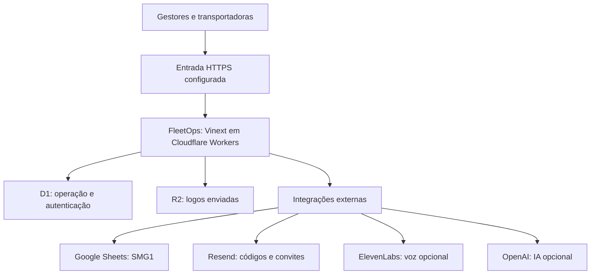

# FleetOps

**Gestão de transportadoras, disponibilidade de frota e pedidos de Scheduling.**

O FleetOps conecta a operação aos portais de cada transportadora. Reúne disponibilidade por ciclo, pedidos de veículos, decisões do gestor, calendarização SMG1, cadastros, permissões e notificações. A Stela oferece ajuda contextual por texto e voz.

**Aplicação:** [fleetops.dev.br](https://fleetops.dev.br/) · **Origem gerenciada:** [Sites](https://disponibilidade-cpm-chp.shadycharm33.chatgpt.site)

## Documentação

| Preciso… | Onde consultar |
| --- | --- |
| Usar os painéis e entender as regras | [Guia de operação](docs/OPERACAO.md) |
| Instalar, preparar o banco local e executar testes | [Desenvolvimento](docs/DESENVOLVIMENTO.md) |
| Entender componentes, dados, autenticação e APIs | [Arquitetura e APIs](docs/ARQUITETURA.md) |
| Configurar segredos, e-mail, calendarização e Stela | [Configuração e integrações](docs/CONFIGURACAO.md) |
| Publicar, manter a instalação e diagnosticar falhas | [Hospedagem e manutenção](docs/HOSPEDAGEM.md) |

## Funcionalidades

| Módulo | Recursos |
| --- | --- |
| Disponibilidade | Quantidades por transportadora, data e ciclo; responsável; observações; confirmação de ausência de veículos; visão geral e CSV. |
| Scheduling | Pedidos com modal, quantidade, protocolo, observações, ambulância e histórico. |
| Decisões da operação | Pendente → feito ou não feito; motivo obrigatório para não feito; informativos no portal da transportadora. |
| Frota fixa | Uma placa por veículo, validação BR/Mercosul, colagem em lote e campos paginados. |
| Calendarização | Conferência automática FF/SDD restrita a SMG1, resultado por placa quando aplicável, reconsulta e contador semanal. |
| Cadastro | Nome e logo, geração do link individual, catálogo geral de modais e liberações por transportadora. |
| Usuários | Abas permitidas por gestor, múltiplos masters, bloqueio de acesso e login por código de e-mail. |
| Alertas | Avisos na tela, som e notificações do navegador para pedidos e decisões. |
| Stela | Base de ajuda, sugestões, contexto autorizado, ditado e leitura; IA generativa e voz ElevenLabs opcionais. |
| Interface | Layout responsivo, tema claro/escuro e respeito à preferência de movimento reduzido. |

## Perfis de acesso

- **Master:** acesso completo, gestão de usuários, remetente de e-mail e configuração da voz da Stela. O master principal é definido no ambiente e protegido contra edição pelo cadastro.
- **Gestor:** visualiza e usa somente as abas liberadas pelo master. A autorização também é conferida nas APIs.
- **Transportadora:** usa seu link exclusivo para informar disponibilidade e acompanhar os próprios pedidos. O link funciona como credencial.

O login dos gestores aceita qualquer e-mail previamente cadastrado e verificado por código; não exige uma conta ChatGPT. A recuperação nativa do master principal depende da origem gerenciada pelo Sites.

## Regras da operação

| Regra | Comportamento |
| --- | --- |
| Ordem dos ciclos | `CPM(CHP)` → `AM` → `PM` → `SD` → `SDE`. |
| Domingo | Somente `AM`, `SD` e `SDE`. |
| Data inicial da tela | Data corrente em `America/Sao_Paulo`, sem fixar a data original de lançamento. |
| Encerramento | Disponibilidade e novos pedidos bloqueados após a virada da data da operação, no horário de Brasília. |
| Status | Pedidos entram como `pending`; a decisão do gestor é separada da consulta de calendarização. |
| Não feito | Exige motivo e gera informativo para a transportadora. |
| Frota fixa | Quantidade de veículos = quantidade de placas válidas e diferentes. Há testes com 2 e 15 veículos; 15 não é um limite do produto. |
| Fonte externa | Somente SMG1; semana/data ausente na planilha é apresentada como período não publicado. |
| Concorrência | Revisões detectam conflitos; identificadores de tentativa impedem duplicação em reenvios. |

O encerramento impede novos envios da transportadora. O gestor pode registrar a conclusão administrativa de um pedido existente, sem reabrir seu envio original.

## Arquitetura



O servidor e os dados da instalação original são gerenciados pelo **Sites**, em Cloudflare Workers, D1 e R2. `hosting/vercel-gateway` contém uma entrada alternativa para essa instalação. `hosting/cloudflare-gateway` contém o código de outra entrada, dependente de publicação e configuração na conta Cloudflare do proprietário. As entradas compartilham o backend; não transferem o banco.

| Camada | Implementação |
| --- | --- |
| Interface | React 19, TypeScript, Tailwind CSS 4, Base UI e ícones Lucide. |
| Aplicação | Vinext, estrutura App Router, Vite e runtime Cloudflare Workers. |
| Dados | Cloudflare D1 / SQLite, Drizzle ORM e migrações SQL versionadas. |
| Arquivos | Cloudflare R2 para logos cadastradas; logos iniciais em `public/logos/carriers`. |
| Login | Better Auth, código de e-mail, sessões HttpOnly e permissões próprias do FleetOps. |
| Testes | Scripts Node.js, Worker/Miniflare e provedores simulados. |

As versões efetivas estão em [package.json](package.json) e [pnpm-lock.yaml](pnpm-lock.yaml).

## Desenvolvimento: início rápido

Use **Node.js 24** e **pnpm 11.25.0**, versão fixada no projeto. Node 24 é a referência para os scripts que importam TypeScript diretamente.

```bash
git clone https://github.com/RomuloLab/fleetops-smg1.git
cd fleetops-smg1
pnpm install --frozen-lockfile
```

1. Copie [docs/examples/dev.vars.example](docs/examples/dev.vars.example) para `.dev.vars` na raiz e preencha os segredos **locais**.
2. Prepare o D1 local:

   ```bash
   pnpm exec wrangler d1 migrations apply DB --local --config docs/examples/wrangler.local.jsonc --persist-to .wrangler/state
   ```

3. Inicie a aplicação:

   ```bash
   pnpm dev
   ```

Em um clone comum, a porta de desenvolvimento é `5173`. Há diferenças entre o perfil portátil e a prévia gerenciada, incluindo a origem esperada por algumas mutações administrativas. Siga [Desenvolvimento](docs/DESENVOLVIMENTO.md) para o primeiro acesso, limites do ambiente local e verificação completa.

### Comandos principais

| Comando | Uso |
| --- | --- |
| `pnpm dev` | Servidor de desenvolvimento. |
| `pnpm build` | Build do cliente e do Worker em `dist/`. |
| `pnpm start` | Executa o **Worker local** já compilado; não publica em produção. |
| `pnpm exec tsc --noEmit` | Verifica os tipos. |
| `pnpm db:generate` | Gera migrações a partir de `db/schema.ts`; revise o SQL antes de aplicar. |
| `node scripts/check-worker.mjs` | Testes integrados após o build, com D1/R2 isolados e serviços externos simulados. |

Os testes integrados não enviam e-mails nem usam créditos reais. O [guia de desenvolvimento](docs/DESENVOLVIMENTO.md) lista as verificações por área.

## Organização do código

| Caminho | Responsabilidade |
| --- | --- |
| `app/` | Páginas, rotas HTTP, componentes da aplicação e estilos. |
| `lib/` | Regras da operação, autorização, cadastros, calendarização, alertas e Stela. |
| `db/` | Esquema e acesso ao D1. |
| `drizzle/` | Migrações SQL e metadados do Drizzle. |
| `config/` | Marca, transportadoras iniciais, modais, logos, liberadores e fonte SMG1. |
| `public/` | Arquivos estáticos, incluindo as logos iniciais. |
| `worker/` | Entrada do Worker e contexto de requisição dos gateways. |
| `hosting/` | Configuração das entradas Vercel e Cloudflare. |
| `scripts/` | Instalação, build, ferramentas da plataforma e testes. |
| `components/`, `hooks/`, `vendor/` | Recursos de suporte; licenças de terceiros preservadas. |
| `docs/` | Documentação operacional e técnica. |

## Integrações e limites

- **Resend:** configure remetente e chave em **Usuários**, como master. O domínio remetente precisa estar verificado. Aceite do serviço não garante chegada à caixa de entrada.
- **Calendarização:** consulta CSV somente leitura, filtrada para SMG1; indisponibilidade da fonte fica explícita e não aprova pedidos automaticamente.
- **Stela:** sem chave de IA, funciona como base de ajuda identificada. A IA generativa é opcional e recebe contexto limitado pelas permissões do solicitante.
- **ElevenLabs:** configure a chave e a voz na engrenagem da Stela, como master. O teto mensal do FleetOps é separado do saldo e do plano do provedor. `402 payment_required` também pode ser restrição da voz ao plano contratado.
- **Notificações:** dependem do navegador, da permissão e da ativação. O acompanhamento exige o site aberto; não há push com o site fechado.

Consulte [Configuração e integrações](docs/CONFIGURACAO.md) e [Diagnóstico de falhas](docs/HOSPEDAGEM.md).

## Publicação e manutenção

A instalação gerenciada usa o fluxo de versões do Sites. Os gateways têm instruções próprias em [Vercel](hosting/vercel-gateway/README.md) e [Cloudflare](hosting/cloudflare-gateway/README.md). A raiz contém um backend Worker e não é um site estático para upload em qualquer hospedagem.

O repositório contém código, migrações, testes, configurações e arquivos estáticos. Registros D1, uploads R2, sessões e segredos de produção são recursos separados: o clone do GitHub não é um backup dos dados operacionais. Veja [Hospedagem e manutenção](docs/HOSPEDAGEM.md) antes de restaurar ou mover uma instalação.
